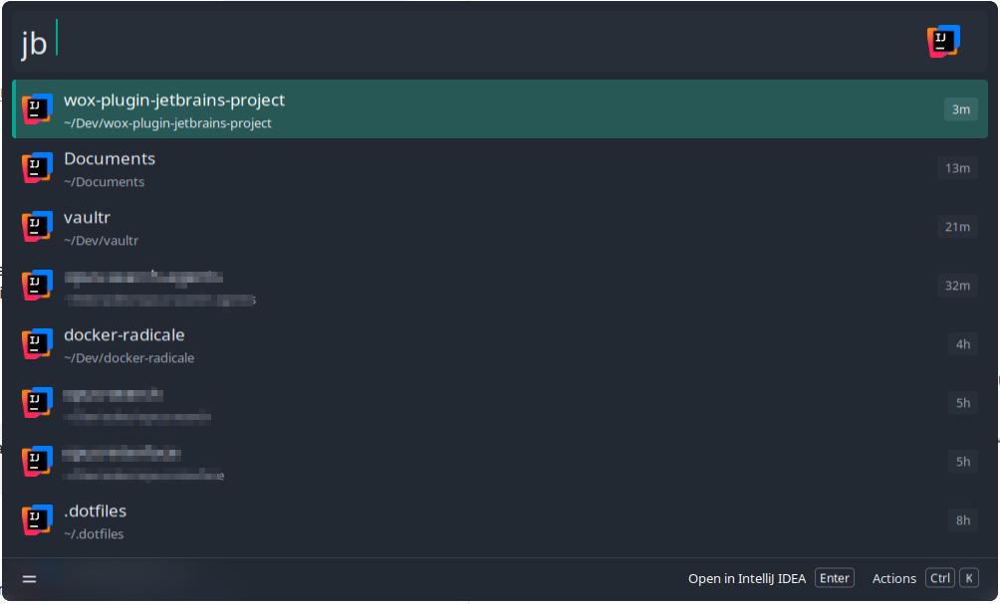

# JetBrains Projects for Wox

Search the recent projects of your JetBrains IDEs from [Wox](https://github.com/Wox-launcher/Wox) and open them.



> **Tested on Linux only**, with IntelliJ IDEA. macOS and Windows are supported in the code but have never been run on a real machine. The other IDEs are covered by automated tests with sample data only. Reports are welcome.

## Usage

| Query | Result |
| --- | --- |
| `jb ` (with the space) | Lists your recent projects, most recent first |
| `jb text` | Searches project names, and you can skip letters (`fyndr` finds `fynodoro`) |

| Key | Action |
| --- | --- |
| `Enter` | Opens the project in the IDE that last used it |
| `Ctrl+K` | Opens the Action Panel: open in another IDE that knows the project, copy the path, or open the folder |

Projects you open also appear on the Wox start page.

## Supported IDEs

Android Studio, Aqua, CLion, DataGrip, DataSpell, GoLand, IntelliJ IDEA, PhpStorm, PyCharm, Rider, RubyMine, RustRover, WebStorm and Writerside.

## Requirements

- Wox 2.4.5 or later
- Python 3.10 or later

## Installation

Download [`Wox.Plugin.JetBrainsProjects.py`](Wox.Plugin.JetBrainsProjects.py) into `~/.wox/wox-user/plugins/single-file/`. Wox loads it right away.

The plugin finds your IDEs by itself, through the install folder each IDE records in its cache, then the `PATH` and JetBrains Toolbox scripts. You don't need to create a command-line launcher.

## Settings

Open them from the Action Panel, or from the installed plugins in the Wox settings.

- **Match project paths**: in `jb` queries, search the project path as well as its name.
- **IDE launchers**: set the path of an IDE's launcher, if the plugin can't find it.
- **Trigger keywords**: add `*` to also see projects in global search, without typing `jb`. Global search only matches project names closely.

## Plugin tools

Other Wox plugins can call `search_projects` and `open_project`.

## Development

### Setup

Install [Lefthook](https://github.com/evilmartians/lefthook) and [uv](https://github.com/astral-sh/uv), then enable the git hooks once per clone:

```bash
lefthook install
```

On each commit, the hook runs [Ruff](https://github.com/astral-sh/ruff) to lint and format the staged Python files, then the tests.

### Tests

The tests use the Wox SDK of a local Wox install:

```bash
uvx --python /usr/bin/python3 pytest
```

Pass the Python interpreter that runs Wox's Python host, shown in the host's process list.

### Running your changes in Wox

Link the plugin into Wox from your clone:

```bash
ln -sfn "$PWD/Wox.Plugin.JetBrainsProjects.py" ~/.wox/wox-user/plugins/single-file/Wox.Plugin.JetBrainsProjects.py
```

Wox doesn't see changes made through a link, so run this command again after each change to reload the plugin.

## Credits

The IDE table, the IDE logos and the Rider file format come from [albert-plugin-python-jetbrains-projects](https://github.com/albertlauncher/albert-plugin-python-jetbrains-projects) (MIT).

The logos belong to JetBrains and Google. This plugin is not affiliated with either company.

## License

[MIT](LICENSE)
